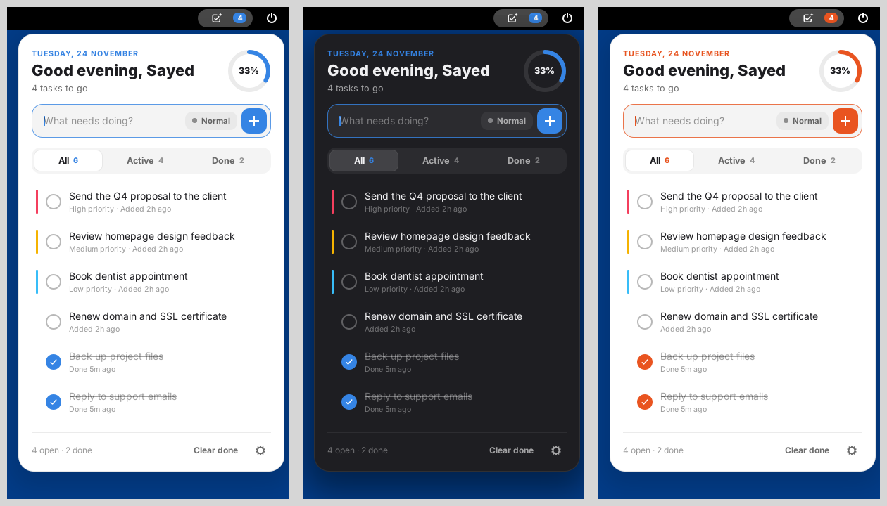

# Nookdo

A small, smoothly animated to-do list that lives in the GNOME top bar.



- **Top-bar popup:** click the icon (or press **Super+Alt+T**) to add, complete, edit and remove tasks.
- **Smooth animations:** opening the popup, adding, completing, removing and filtering are all animated, and finishing everything earns a little confetti.
- **Gentle reminders:** optionally pops open every N minutes (60 by default), only while you still have open tasks. It never interrupts fullscreen apps and hides itself again if you don't touch it.
- **Fits your desktop:** follows the system light/dark style and accent colour (Ubuntu's Yaru accents included).
- **Priorities, filters and undo:** Low / Medium / High priorities; All / Active / Done filters; undo for deletes and "Clear done".
- **Local storage:** tasks are saved in `~/.local/share/nookdo/tasks.json`. Nothing leaves your machine.

Supports GNOME Shell 45–51 (Ubuntu 23.10 and newer).

## Install

**From extensions.gnome.org:** one-click install, no logout needed *(listing coming soon)*.

**From source:**
```bash
git clone https://github.com/sfaisaldev/nookdo.git
cd nookdo
./install.sh
```
On Wayland, log out and back in once after the first install. GNOME only discovers new extensions at login.

## Keyboard

| Shortcut | Action |
| --- | --- |
| Super+Alt+T | Open / close the popup |
| Enter | Add the task |
| Ctrl+1 / 2 / 3 | Set Low / Medium / High priority while typing (Ctrl+0 clears it) |
| Double-click a task | Edit it |
| Esc | Cancel editing / close |

## Settings

Open from the ⚙ button in the popup, or run `gnome-extensions prefs nookdo@sfaisal.dev`.

- Reminders: on/off, interval, auto-hide delay, skip while fullscreen, preview
- Style: follow system, light or dark
- Accent colour: system accent, or blue, teal, green, orange, red or graphite
- Top-bar task count, confetti, completed tasks at the bottom
- Keyboard shortcut

## Development

```bash
./install.sh                                         # copy to ~/.local/share/gnome-shell/extensions and enable
journalctl -f -o cat /usr/bin/gnome-shell            # live logs
./pack-for-ego.sh                                    # build the zip for extensions.gnome.org
```

To test without logging out, run a nested session. On GNOME 49 and newer:
```bash
dbus-run-session gnome-shell --devkit --wayland
```
On GNOME 45–48:
```bash
dbus-run-session -- gnome-shell --nested --wayland
```

## Troubleshooting

If the icon doesn't appear after logging back in:
```bash
gnome-shell --version
gnome-extensions info nookdo@sfaisal.dev
journalctl -b -o cat /usr/bin/gnome-shell | grep -i -B2 -A8 nookdo
```

## License

GPL-2.0-or-later. See [LICENSE](LICENSE).
